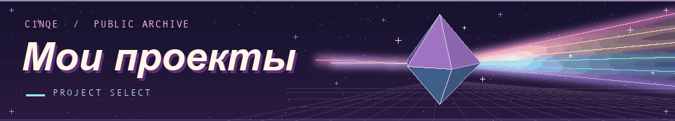
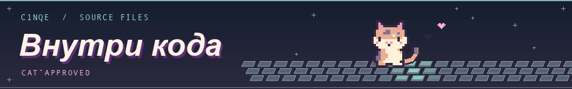

  

<h1 align="center">охаё, я c1nqe ♡</h1>

  Я фембой, пишу бэкенд на <strong>C++</strong> и ставлю чайник, пока всё компилируется. 
  За код-ревью отвечает кот. Замурчал — можно мёржить.

  
  
  

<h2>
  <picture>
    <source media="(prefers-reduced-motion: reduce)" srcset="https://raw.githubusercontent.com/c1nqe/c1nqe/main/assets/project-select.png">
    
  </picture>
</h2>

### Веб-приложения

- **[SBERconverter](https://github.com/c1nqe/SBERconverter)** — генератор конвертеров на TypeScript. Загружаешь таблицу и, если нужно, пример желаемого JSON. Бэкенд на FastAPI разбирает файл, GigaChat генерирует функцию преобразования, а из интерфейса на React её можно скачать как `.ts`.
- **[CyberShield](https://github.com/c1nqe/CyberShield)** — тренажёр цифровой безопасности. В учебном почтовом ящике можно разобрать подозрительное письмо, выбрать действие и узнать, какие детали выдавали фишинг. Интерфейс написан на Next.js, а бэкенд на FastAPI сохраняет прогресс и достижения в PostgreSQL.
- **[Учёт волонтёров ДГТУ](https://github.com/c1nqe/VolontiersDSTU)** — проект для хакатона «ВЕСНА ’25». Волонтёр записывается на событие, организатор подтверждает часы, а волонтёр получает выписку за выбранный период. Демо на JavaScript хранит данные в браузере. В репозитории также есть GraphQL-клиент для DataSpace.

### Telegram-боты

- **[CRM Bot](https://github.com/c1nqe/crm-bot)** помогает вести сделки прямо в чате. В карточке клиента можно завести сделку и поставить напоминание о следующем звонке. Бот написан на Python с aiogram, хранит записи в SQLite и умеет выгружать их в Excel.
- **[Task Manager Bot](https://github.com/c1nqe/taskmanager-bot)** раскладывает задачи по проектам. В Telegram можно выставить приоритет и дедлайн, а потом отметить задачу выполненной. Celery и Redis отвечают за фоновые напоминания. Для работы с задачами из других приложений есть REST API на FastAPI.

### Сайты и вёрстка

- **[SITEVISIT](https://github.com/c1nqe/SITEVISIT)** — моя визитка как бэкенд-разработчика. На одной странице собраны технологии и карточки проектов со ссылками на код. На телефоне разделы открываются через компактное меню. [Открыть сайт ↗](https://c1nqe.github.io/SITEVISIT/)
- **[Портфолио веб-разработчика](https://github.com/c1nqe/-)** — здесь можно посмотреть на мои работы по вёрстке. На странице две карточки — строительное бюро и магазин гаджетов. При прокрутке JavaScript анимирует блоки и шкалы навыков.
- **[SiteCorp](https://github.com/c1nqe/SiteCorp)** — многостраничный сайт строительного бюро Createx. Услугам, портфолио объектов и новостям посвящены отдельные HTML-страницы. Общие стили написаны на SCSS.
- **[Device](https://github.com/c1nqe/device-site)** — учебная вёрстка магазина гаджетов по макету HTML Academy. С главной можно перейти в каталог моноподов, открыть карту магазина или вызвать форму обратной связи. За всплывающие окна отвечает JavaScript.

### Ещё в профиле

- **[ndvimonitor](https://github.com/c1nqe/ndvimonitor)** — пока пустой репозиторий.
- **[c1nqe](https://github.com/c1nqe/c1nqe)** — исходники этой страницы. Здесь живут баннеры, лазеры и кот, который ревьюит код ♡

<h2>
  <picture>
    <source media="(prefers-reduced-motion: reduce)" srcset="https://raw.githubusercontent.com/c1nqe/c1nqe/main/assets/cat-review.png">
    
  </picture>
</h2>

- Как свести CSV, Excel и JSON к одной структуре данных в **SBERconverter**. [Посмотреть парсеры →](https://github.com/c1nqe/SBERconverter/blob/main/servis/parsery.py)
- Как **CyberShield** проверяет ответы игрока и сохраняет результат миссии. [Открыть обработку прогресса →](https://github.com/c1nqe/CyberShield/blob/main/backend/app/services/progress_service.py)
- Как **Task Manager Bot** находит просроченные задачи и отправляет напоминания в Telegram. [Посмотреть фоновые задачи →](https://github.com/c1nqe/taskmanager-bot/blob/main/celery_tasks.py)

  

<a href="#projects">↑ Вернуться к проектам</a>

